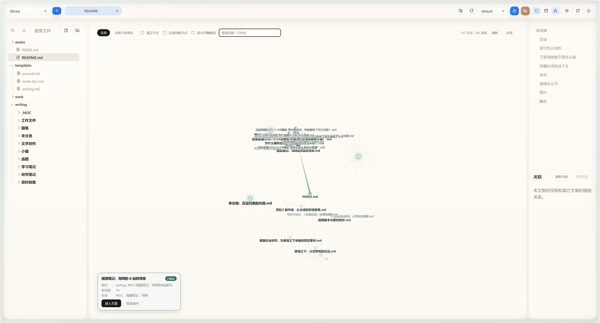
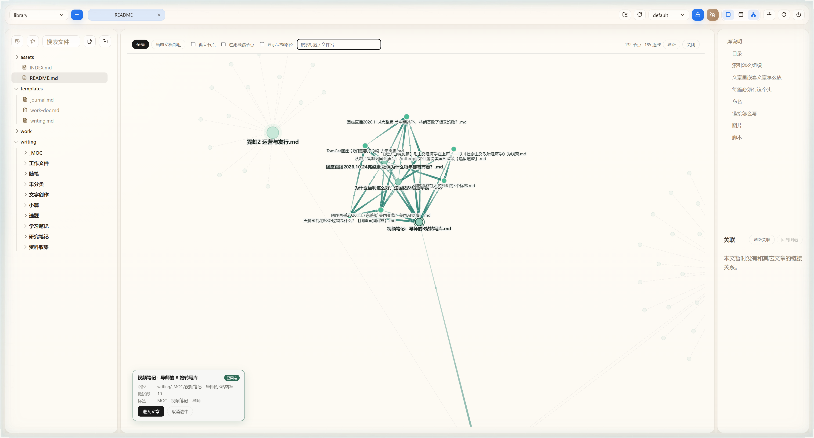

# 选中后一跳邻居名称必显

2026-11-14。用户反馈选中视频笔记 MOC 后部分相连节点没有名称，需要放大才能出现。

原因：一跳节点已通过 drawLabels 候选筛选，但未加入 forced，仍会被 collides(box) 或普通标签数量上限剔除。修复将选中的 related 集合加入必显；GraphView 的 highlightDepth 为 1，覆盖出链及反链邻居。未改变布局、物理参数、搜索、节点过滤或 library 内容。

## 验收

- `npx vitest run tests/graph`：31/31 通过，新增 4 项用例（0.06 / 0.2 / 1 缩放下名称碰撞、一跳双向邻居、两跳排除及取消选中；另验证 405 个邻居不受 400 普通标签上限影响）。日志 `temp/neighbor-label-tests.log`。
- `npx tsc -b`：通过，日志 `temp/neighbor-label-tsc.log`。
- `npx vite build`：通过，日志 `temp/neighbor-label-build.log`。
- 整体替换 vendor/dist，旧产物留在 temp；ghost_forge_install 返回 updated。library_open 服务 ready=true，侧栏自动打开曾返回 HOST_NOT_READY，随后直接通过原浏览器验收成功。health ok:true。
- 作者与安装目录的 server/*.mjs 和 dist/index.html 哈希一致，日志 `temp/neighbor-label-hashes.log`。

真实库当时 145 节点、185 边，默认图显示 132 节点。选中 `writing/_MOC/视频笔记：导师的B站转写库.md`，接口直接相连邻居 10 个（含 INDEX）。清空搜索后记录 Canvas 实际 fillText 调用；缩放 0.5077 和 0.146 时，10 个邻居名称全部绘制，missing=[]。因此不是搜索强显掩盖了缺失。

名称在极密集区域仍可能重叠；本轮遵从“全部显示”，不通过避让隐藏，也不修改节点布局。仅保证当前显示图中的一跳名称，未解除导航/孤立节点过滤。
