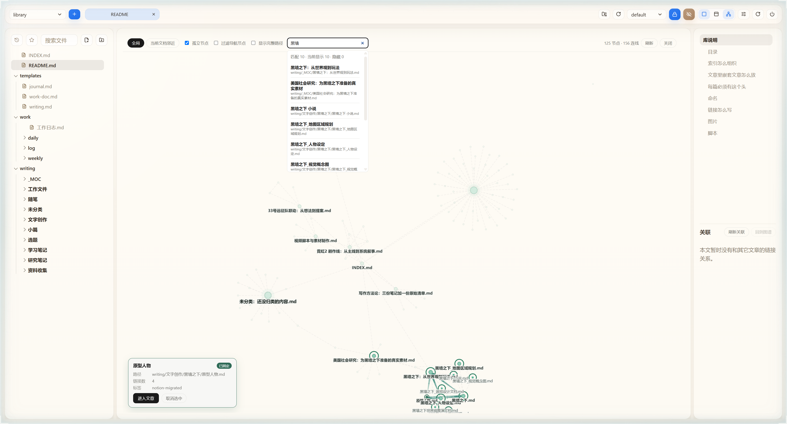
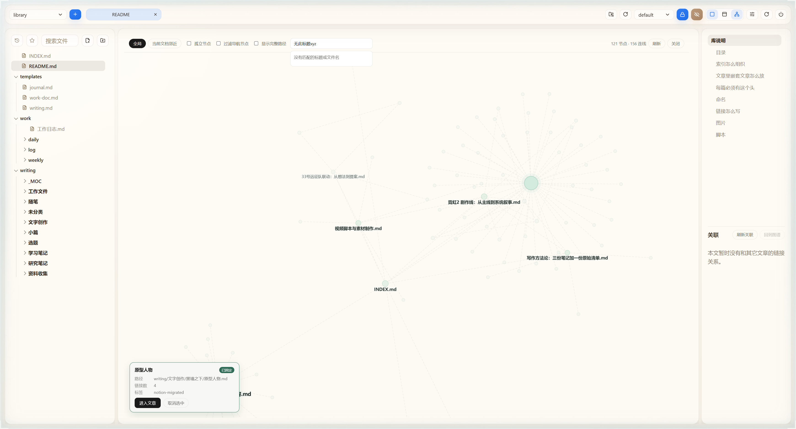

# 图谱标题／文件名搜索验收

2026-11-14。第一阶段已实现并安装到 Cindy 本地大书库；全文搜索仍待后续。

## 使用规则

工具栏输入后立即高亮，无搜索按钮。匹配 title 或文件名，不搜目录；大小写不敏感，多个空白分隔词需全部命中，中文输入法结束组词后更新。结果显示标题和路径，可点击选中并固定信息面板；输入本身不修改选择、相机、布局或关系。清空（或 Escape）恢复原观感。

被导航、孤立节点或局部范围隐藏的结果计入总命中并标明隐藏。点击“切到全局并显示隐藏节点”才切全局并开启导航、孤立节点；这是明确的显示范围变化，会按原有规则重建拓扑。查询本身不会改变范围。

## 验证结果

- `npx vitest run tests/graph tests/app/app-session-restore.test.tsx tests/app/document-backlinks.test.tsx`：54/54 通过，新增 7 项搜索用例；日志 `temp/search-tests.log`。
- `npx tsc -b`：通过，日志 `temp/search-tsc.log`。
- `npx vite build`：通过，日志 `temp/search-build.log`。
- 使用已有依赖，未增加包或改变 lockfile。未重跑全套已有失败的 local-bridge 测试，未修改其断言。
- author 的 vendor/dist 整体替换（旧目录移到 temp 留备份），`ghost_forge_install` 返回 updated；`library_open` 启动成功，health `ok:true`。
- 安装目录与作者目录 `vendor/server/*.mjs`、`vendor/dist/index.html` 哈希一致，日志 `temp/search-installed-hashes.log`；未修改 server 或 mechanics。

真实库 `library-c6c86f25` / default：索引 125 节点、156 边、broken 0；默认图 121 节点，隐藏 4 个孤立节点。

| 操作 | 实际结果 |
|---|---|
| 搜索“黑墙” | 10 条命中；默认 10 可见、0 隐藏 |
| 搜索“原型” | 2 条：原型人物、故事原型&点子 |
| 点“原型人物”结果 | selectedId 为该文件完整路径；信息面板“已固定” |
| 已恢复的静止图中输入、零结果、清空 | positions、camera、selectedId 序列化前后完全相同；hasEngine=false |
| 搜索“无此标题xyz” | 明确显示没有匹配的标题或文件名 |
| 过滤导航后搜“黑墙” | 10 命中、8 可见、2 隐藏；隐藏结果按钮禁用 |
| 显示隐藏节点 | 125 节点；10 命中全部可见 |
| 搜索中用真实鼠标拖节点 | 坐标变化，原有选中保持，搜索命中仍为 10；自动化拖拽邻居回归用例也通过 |

初次布局仍在仿真时，位置会按正常冷却变化，因此“输入不移动布局”以恢复后的无仿真图对照；不能将正常仿真误判为搜索重排。搜索结果可见数量指通过显示过滤的节点数，不表示全部已落在当前相机视口中。点击结果不会自动定位相机，用户可自行平移缩放。

## 截图

## 后续边界

未实现全文、拼音、模糊匹配、语义搜索；未做千篇库性能基准。全文需独立服务端缓存、正文解析、失效与请求乱序控制，不能逐篇从浏览器拉正文。现阶段只复用已有索引，无额外扫描。
